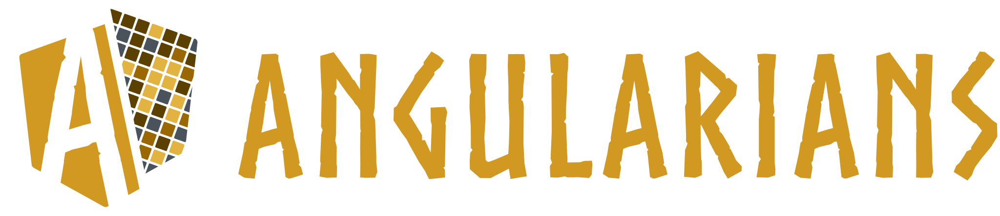
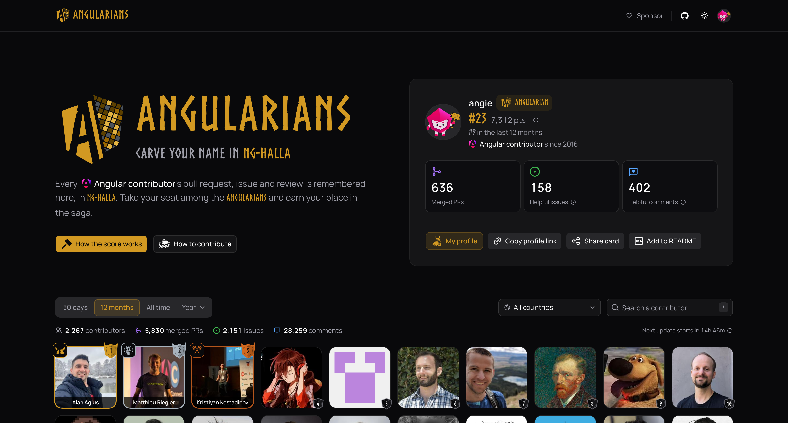
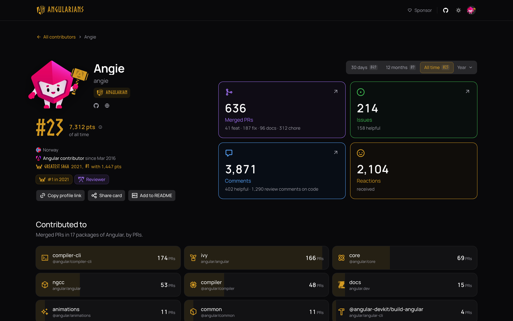

<h1 align="center"></h1>

<p align="center">
  <a href="https://angularians.dev"></a>
  <a href="https://app.netlify.com/projects/angularians/deploys"></a>
  <a href="LICENSE"></a>
  <a href="https://github.com/sponsors/erkamyaman"></a>
</p>

<p align="center">
  <b>Carve your name in ng-halla.</b><br>
  Every Angular contributor's pull request, issue, discussion, review and security report is remembered here, in ng-halla.<br>
  Take your seat among the Angularians and earn your place in the saga.<br><br>
  Everyone who has contributed since 2014, ranked at <b><a href="https://angularians.dev">angularians.dev</a></b> and updated every night.<br>
  Inspired by <a href="https://nuxt.com/nuxters">Nuxters</a>, built for Angular.
</p>

<p align="center">
  
</p>

<p align="center">
  
</p>

## Quick start

You need Node 24 (`.nvmrc`) and pnpm 10.

```sh
git clone https://github.com/erkamyaman/angularians.git
cd angularians
pnpm install
pnpm dev     # http://localhost:4202, with the data in data/
pnpm test
```

The data is already in `data/`: you do not need a GitHub token to work on the site. To collect it yourself, see
[collector/README.md](collector/README.md).

## Features

- A leaderboard of [angular/angular](https://github.com/angular/angular), [angular/components](https://github.com/angular/components),
  [angular/angular-cli](https://github.com/angular/angular-cli), [angular/dev-infra](https://github.com/angular/dev-infra),
  [angular/domino](https://github.com/angular/domino), and the archived [angular/zone.js](https://github.com/angular/zone.js)
  and [angular/universal](https://github.com/angular/universal): merged pull
  requests, issues, discussions, comments, code reviews and security reports. [How the score works](docs/SCORING.md).
- The last 30 days, the last 12 months, all time and every year, by country, with a globe.
- A profile for everyone: stats, badges and year by year, with the packages they contributed to, down to
  angular.dev and the Angular agent skills.
- Sign in with GitHub to see your rank and badges, share your profile and add your Angularian card to your GitHub README.
- Custom badges for the people behind Angular community projects, each with its own title, logo and colour ("Analog alchemist"), linked to the project and shown on the Angularian card.
- Link previews for every profile and period, drawn on the server: share a link and it shows your card. Pick a
  period for your README card and only what changes reloads.
- Dark and light themes.
- A public JSON API. How it all fits: [docs/ARCHITECTURE.md](docs/ARCHITECTURE.md).

## Built with

[Angular](https://angular.dev) and [AnalogJS](https://analogjs.org) for the site, server-rendered;
[spartan/ui](https://spartan.ng) for the components and [ng-icons](https://ng-icons.github.io/ng-icons) for the icons;
[Tailwind CSS](https://tailwindcss.com) for the styles;
[satori](https://github.com/vercel/satori) and [resvg](https://github.com/thx/resvg-js) for the share cards;
[cobe](https://github.com/shuding/cobe) for the globe;
GitHub Actions for the nightly collection, and [Netlify](https://www.netlify.com) to host it all.

The Viking icons are by Lorc and Delapouite from [Game Icons](https://game-icons.net), the flags from
[circle-flags](https://github.com/HatScripts/circle-flags). All credits: [THIRD_PARTY_NOTICES.md](THIRD_PARTY_NOTICES.md).

<p>
  
  
  
  
  
  
  
</p>

## The brand

The mark is the Angular shield cut in two: the A of [Norse](https://www.joelcarrouche.net) on one side, a contribution
graph on the other, in Viking gold (`#9A6700`, and the brighter `#D29922` on dark) and the grey of empty days. Its construction is in
[`app/scripts/logo`](app/scripts/logo). About the Norse font: [THIRD_PARTY_NOTICES.md](THIRD_PARTY_NOTICES.md).

## Contributing

See [CONTRIBUTING.md](CONTRIBUTING.md) and the [Code of Conduct](CODE_OF_CONDUCT.md). New here? Start with a
[good first issue](https://github.com/erkamyaman/angularians/labels/good%20first%20issue). Report security problems through
[SECURITY.md](SECURITY.md).

## Maintainers

<!-- prettier-ignore-start -->
<table>
  <tbody>
    <tr>
      <td align="center" valign="top" width="14.28%"><a href="https://github.com/erkamyaman"><br /><sub><b>Erkam Yaman</b></sub></a><br /><sub>Maintainer</sub></td>
    </tr>
  </tbody>
</table>
<!-- prettier-ignore-end -->

## Contributors

Thanks to everyone who has helped. This project follows the [all-contributors](https://allcontributors.org) specification. Contributions of any kind welcome!

<!-- ALL-CONTRIBUTORS-LIST:START - Do not remove or modify this section -->
<!-- prettier-ignore-start -->
<!-- markdownlint-disable -->
<table>
  <tbody>
    <tr>
      <td align="center" valign="top" width="14.28%"><a href="https://github.com/erkamyaman"><br /><sub><b>Erkam Yaman</b></sub></a><br /><a href="https://github.com/erkamyaman/angularians/commits?author=erkamyaman" title="Code">💻</a> <a href="#design-erkamyaman" title="Design">🎨</a> <a href="https://github.com/erkamyaman/angularians/commits?author=erkamyaman" title="Documentation">📖</a> <a href="#infra-erkamyaman" title="Infrastructure (Hosting, Build-Tools, etc)">🚇</a> <a href="#maintenance-erkamyaman" title="Maintenance">🚧</a></td>
      <td align="center" valign="top" width="14.28%"><a href="https://skyzerozx.com/"><br /><sub><b>Jaime Burgos</b></sub></a><br /><a href="https://github.com/erkamyaman/angularians/commits?author=SkyZeroZx" title="Code">💻</a></td>
      <td align="center" valign="top" width="14.28%"><a href="https://linktr.ee/ngxsamurai"><br /><sub><b>Ali Elderov</b></sub></a><br /><a href="#ideas-WuglyakBolgoink" title="Ideas, Planning, & Feedback">🤔</a> <a href="https://github.com/erkamyaman/angularians/issues?q=author%3AWuglyakBolgoink" title="Bug reports">🐛</a></td>
      <td align="center" valign="top" width="14.28%"><a href="https://www.abikb.xyz/"><br /><sub><b>Abiram</b></sub></a><br /><a href="https://github.com/erkamyaman/angularians/issues?q=author%3Aabiramcodes" title="Bug reports">🐛</a></td>
      <td align="center" valign="top" width="14.28%"><a href="https://gerome.dev"><br /><sub><b>Gerome Grignon</b></sub></a><br /><a href="#ideas-geromegrignon" title="Ideas, Planning, & Feedback">🤔</a></td>
    </tr>
  </tbody>
</table>

<!-- markdownlint-restore -->
<!-- prettier-ignore-end -->

<!-- ALL-CONTRIBUTORS-LIST:END -->

## License

MIT License © 2026 [Erkam Yaman](https://github.com/erkamyaman). The code ported from Nuxters keeps the MIT notices of NuxtLabs and Nuxt:
[THIRD_PARTY_NOTICES.md](THIRD_PARTY_NOTICES.md).

Angularians is an independent community project. It is not affiliated with, or endorsed by, Google or the Angular team.
Angular is a trademark of Google LLC.
